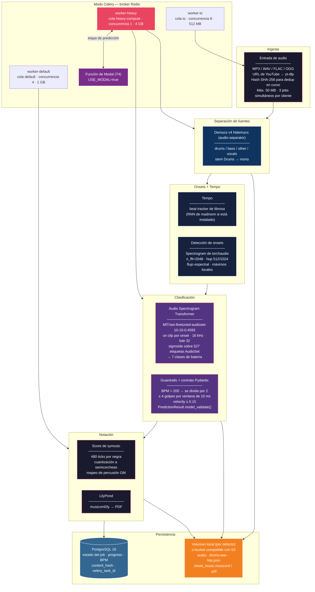
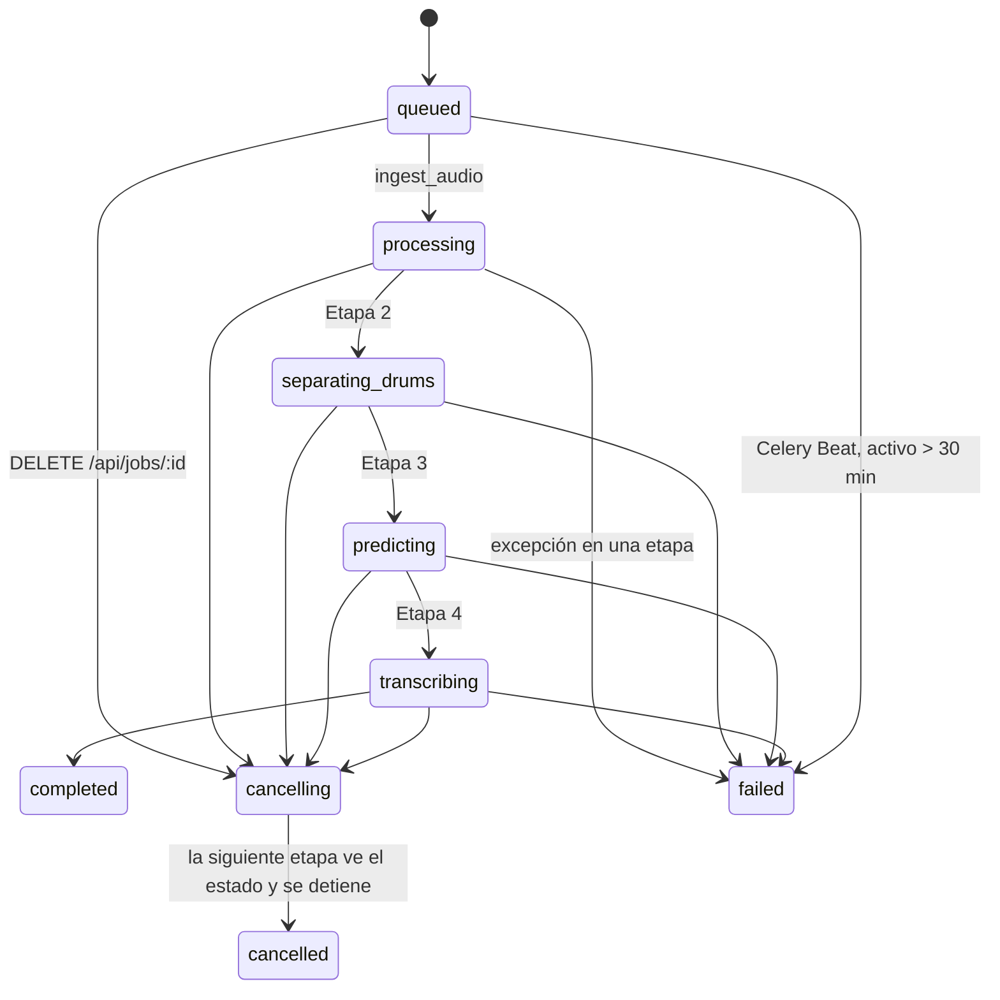

[](README.md)

# CDrumscribe — Transcripción Automática de Batería

> **CDrumscribe** es el nombre del proyecto. El repositorio se llama `Automatic-Drum-Transcription`, y el código, los contenedores y el título de la API usan el nombre de trabajo `DrumScribe`. Los tres se refieren al mismo proyecto.

CDrumscribe recibe una canción (un archivo de audio o una URL de YouTube). Separa las fuentes del audio, detecta los ataques (*onsets*) de la batería, etiqueta cada uno con un clasificador de audio preentrenado y cuantiza los golpes en una partitura de batería (MusicXML, más un PDF generado con LilyPond). Funciona como un backend FastAPI con un frontend Next.js, en dos modos: un MVP de un solo contenedor y un stack de varios workers con Celery.

<div align="center">

| Ingesta | Separación | Onsets + clasificación | Salida |
|---|---|---|---|
| Archivo / YouTube (yt-dlp) | Demucs v4 (`htdemucs`) vía `audio-separator` | Flujo espectral STFT → AST (AudioSet) | Partitura symusic → MusicXML / PDF |

</div>

---

## Estado del Proyecto

Es un proyecto personal. Este es su estado, verificado contra el código el 2026-10-23 (después de las correcciones del pipeline en #2):

- **Funciona de punta a punta:** desde un clon limpio, el stack MVP se construye y procesa un job por las cuatro etapas. Con un loop de prueba de 10 segundos (laptop, solo CPU), termina en unos 5 minutos y devuelve un MusicXML descargable. La etapa de PDF genera el archivo cuando la partitura tiene notas (verificado con una partitura de ejemplo).
- **La calidad de detección es el problema abierto:** en ese loop sintético, AST **no etiquetó ningún golpe**, así que la partitura salió vacía, aunque el tempo estimado fue correcto (99 contra 100 BPM). La causa es estructural: AST espera entradas de ~10 s, así que cada clip de ~150 ms se rellena hasta 1024 frames. Eso deja las probabilidades de batería en ~0.1, debajo del umbral de 0.3, y hace que cada clip cueste una pasada completa de 10 s. El próximo paso es un clasificador entrenado con golpes cortos de batería.
- **Sin evaluar todavía:** no hay un benchmark de precisión de transcripción (por ejemplo, F-measure en ENST-Drums o MDB Drums). Es el principal próximo paso.
- **Clasificador:** el modelo AST es el checkpoint estándar de AudioSet, usado sin entrenamiento adicional (*zero-shot*). Sus 527 etiquetas de AudioSet se mapean por nombre a clases de batería. No se ajustó con datos de batería.

---

## Arquitectura del Sistema

Los dos modos de despliegue comparten el mismo código. En **modo MVP** (`USE_CELERY=false`), la API ejecuta las cuatro etapas dentro del mismo proceso, como tarea en segundo plano de FastAPI. En **modo Celery**, las mismas cuatro funciones corren como una cadena de Celery sobre tres colas, cada una atendida por su propio servicio de workers. Con `USE_MODAL=true`, la etapa de predicción llama a una función de Modal en una NVIDIA T4 en lugar de correr localmente.



### Secuencia por Etapas

```mermaid
sequenceDiagram
    participant API as FastAPI
    participant IO  as worker-io
    participant HV  as worker-heavy
    participant DF  as worker-default
    participant DB  as PostgreSQL
    participant S3  as Almacenamiento

    API->>DB: INSERT job (status=queued)
    API->>IO: despacha la cadena de Celery (o en proceso, en modo MVP)

    rect rgb(20, 40, 60)
    Note over IO: Etapa 1 — Ingesta (5–15%)
    IO->>S3: descarga (YouTube) o ubica el archivo, valida la señal
    IO->>DB: progress=15
    end

    rect rgb(30, 20, 60)
    Note over HV: Etapa 2 — Separación (20–50%)
    HV->>S3: carga el audio fuente
    HV->>HV: Demucs htdemucs vía audio-separator
    HV->>S3: guarda drums.wav (mono, promedio de canales)
    HV->>DB: progress=50
    end

    rect rgb(50, 20, 60)
    Note over HV: Etapa 3 — Onsets + Clasificación (55–75%)
    HV->>HV: estimación de tempo (librosa) → flujo espectral STFT → picos
    HV->>HV: AST lote=32 → sigmoide → 7 clases de batería
    HV->>HV: guardrails + validación de PredictionResult
    HV->>S3: guarda hits.json
    HV->>DB: progress=75
    end

    rect rgb(20, 40, 30)
    Note over DF: Etapa 4 — Notación (80–100%)
    DF->>S3: carga hits.json
    DF->>DF: Score de symusic, cuantización a semicorcheas
    DF->>DF: exportación MusicXML → PDF con LilyPond
    DF->>S3: guarda sheet_music.musicxml + .pdf
    DF->>DB: progress=100, status=completed
    end
```



### Ciclo de Vida del Job



---

## Decisiones de Diseño

### Detección de Onsets — STFT Lineal y Flujo Espectral

`app/ml/onset_detection.py` calcula un **espectrograma de magnitud lineal** (`torchaudio.transforms.Spectrogram`, `n_fft=2048`, `power=1.0`). El hop es de 512 muestras cuando el tempo estimado supera 110 BPM y de 1024 en otro caso. La envolvente de onsets es el flujo espectral positivo sumado sobre las bandas de frecuencia y normalizado a [0, 1]. Los onsets son los máximos locales por encima de un umbral fijo (`ONSET_SENSITIVITY`, 0.05 por defecto).

El razonamiento: la escala Mel comprime las frecuencias altas, que es justo donde está buena parte de la diferencia entre hi-hats, platillos y redoblante. Un espectrograma lineal conserva ese rango para el cálculo del flujo. La transformación corre con tensores de torch, y la selección de picos es un bucle simple sobre la envolvente en NumPy.

### Clasificación — AST, Zero-Shot

Cada onset se convierte en un clip de más o menos una semicorchea al tempo estimado. El clip se estira o comprime a 8820 muestras, se remuestrea a 16 kHz y se agrupa en lotes de 32 para `MIT/ast-finetuned-audioset-10-10-0.4593`. El modelo devuelve probabilidades sigmoides sobre las 527 clases de AudioSet. Las etiquetas por encima de 0.3 se mapean por nombre (`AUDIOSET_TO_DRUM_MAP`) a 7 clases de batería: bombo, redoblante, hi-hat cerrado/abierto, ride, crash y tom agudo. El modelo se entrenó con audio general de AudioSet, no con golpes de batería aislados, así que su precisión por clase en esta tarea no está medida (ver Estado del Proyecto).

### Exportación a ONNX — Validada, Aún Fuera del Camino de Inferencia

`backend/scripts/export_ast_to_onnx.py` exporta AST a ONNX (opset 14, ejes dinámicos de lote y secuencia). Comprueba que las salidas de ONNX Runtime coincidan con las de PyTorch dentro de `1e-4` y luego mide el tiempo de ambos. La inferencia en `app/ml/engine.py` todavía usa PyTorch. Pasarla a ONNX Runtime está planeado.

Medido el 2026-10-22 corriendo ese script sin cambios dentro de la imagen MVP (con `onnxscript` agregado, porque torch 2.14 lo necesita para exportar). Entorno: AMD Ryzen 5 5500U bajo WSL2, solo CPU, torch 2.14.1+cpu, onnxruntime 1.31 con opciones de sesión por defecto, una entrada de 10 segundos (banco de filtros `1×1024×128`), 5 corridas de calentamiento y 100 corridas medidas de cada uno. Las salidas coincidieron (diferencia absoluta máxima de 1.2e-05). **ONNX Runtime fue más lento: 6.59 s contra 3.20 s por pasada (0.49x)**. La aceleración que citan documentos anteriores no se reproduce aquí. Todavía no se exploraron la optimización del grafo, la configuración de hilos ni la cuantización.

### Notación — symusic

`app/services/transcription.py` arma un `symusic.Score` a 480 ticks por negra. Asigna cada clase de batería a una nota de percusión General MIDI en una pista de batería y ajusta los ataques a una grilla de semicorcheas derivada del tempo. También registra en el log el desvío promedio y máximo de la cuantización, en milisegundos. symusic es una biblioteca con núcleo en C++. Sus benchmarks publicados muestran un parseo de MIDI mucho más rápido que `mido`, `pretty_midi` y `miditoolkit` ([según los benchmarks de symusic](https://github.com/Yikai-Liao/symusic#benchmark)). Este proyecto no midió su propia etapa de cuantización.

---

## Medidas de Confiabilidad

| Tema | Qué hace el código |
|---|---|
| Costo de carga de modelos | El modelo de separación y AST se cargan una vez por proceso (singletons protegidos con un lock). El `worker-heavy` de Celery precarga ambos al arrancar (`WORKER_MODE=true`). |
| Archivos duplicados | Los archivos se hashean con SHA-256. Si el mismo cliente ya tiene un job en curso con el mismo hash, la API devuelve ese job en lugar de crear uno nuevo. |
| Reintentos tras una falla parcial | La etapa 2 omite la separación si `drums.wav` ya existe. La etapa 3 reutiliza `hits.json` si pasa la validación de `PredictionResult`. |
| Memoria | `worker-heavy` corre con `concurrency=1` y un límite de 4 GB. Las etapas liberan los arreglos grandes y llaman a `gc.collect()` / `torch.cuda.empty_cache()`. |
| Tamaño de imagen | `torch`/`torchaudio` se instalan desde el índice de wheels CPU de PyTorch para no traer el stack de CUDA. |
| Jobs trabados | En modo Celery, Celery Beat marca como `failed` los jobs activos por más de 30 minutos y borra los artefactos con más de `ARTIFACT_TTL_HOURS` (24 h). |

### Diseño de Colas

`docker-compose.yml` define tres colas, cada una atendida por su propio servicio de workers, para que las descargas lentas y la inferencia pesada en CPU no compitan por los mismos slots:

```
io              concurrency=8   512 MB   descarga de YouTube, validación de archivos
heavy-compute   concurrency=1   4 GB     separación Demucs + inferencia AST
default         concurrency=4   1 GB     cuantización symusic, exportación MusicXML/PDF
```

`worker-heavy` ejecuta una tarea a la vez porque mantiene ambos modelos en memoria dentro de un contenedor de 4 GB.

### Contratos Pydantic en el Borde del Modelo

```python
class DrumHit(BaseModel):
    time:       float = Field(ge=0.0)
    instrument: str   = Field(pattern="^(kick|snare|hihat_closed|hihat_open|ride|crash|tom_high|tom_mid|tom_low)$")
    velocity:   float = Field(ge=0.0, le=1.0)
    model_config = {"frozen": True}
```

`PredictionResult` además exige BPM en [40, 300], confianza en [0, 1], golpes ordenados por tiempo y un `hit_summary` que coincida con la lista de golpes. `run_prediction()` valida su salida con `model_validate()` antes de devolverla. Después el worker aplica tres heurísticas (`app/ml/guardrails.py`) antes de escribir `hits.json`:

- **Tempo duplicado:** un BPM mayor a 200 se divide por 2 y se marca como `bpm_unreliable`.
- **Límite de polifonía:** como máximo 4 golpes por ventana de 10 ms; se conservan los de mayor confianza.
- **Piso de confianza:** se descartan los golpes con `velocity < 0.15`.

---

## GPU Serverless (Modal)

`backend/infrastructure/modal_app.py` define una app de Modal (`drumscribe-ml`) con una función, `process_audio_pipeline`. Corre en una T4 con 8 GB de RAM y un timeout de 600 s, y los pesos de los modelos quedan incluidos en la imagen al construirla. Ejecuta la separación, la clasificación con AST y los guardrails, y devuelve un resultado validado con Pydantic. Con `USE_MODAL=true`, la etapa `predict_hits` envía el audio a esa función. Si el SDK de Modal o la función desplegada no están disponibles, vuelve a la inferencia local. El autor la desplegó y corrió jobs a través de ella manualmente. No se midieron ni la latencia ni el costo.

Criterio de costo (sin medir): Modal cobra por segundo de uso y escala a cero, lo que se ajusta mejor a jobs esporádicos y en ráfagas que una instancia GPU siempre encendida.

---

## Stack Tecnológico

| Capa | Tecnología | Rol |
|---|---|---|
| **Frontend** | Next.js 16, React 19, TypeScript | UI de carga, Server Actions, progreso por SSE (`EventSource`) |
| **Render de partitura** | OpenSheetMusicDisplay | Render de MusicXML en el navegador |
| **API** | FastAPI, SQLAlchemy (async), Pydantic v2 | API de jobs, stream SSE, esquemas tipados |
| **Cola de tareas** | Celery + Redis | Tres colas; Celery Beat para limpieza y vencimiento de jobs |
| **Separación** | Demucs v4 `htdemucs` vía `audio-separator` | Separación del stem de batería; modelo configurable con `SEPARATION_MODEL` |
| **Detección de onsets** | STFT de torchaudio + flujo espectral | Tiempos de ataque |
| **Tempo** | librosa (madmom si está instalado) | Estimación de BPM para ventanas y cuantización |
| **Clasificación de golpes** | AST (AudioSet), PyTorch | Clip del onset → clase de batería; hay un script de exportación a ONNX |
| **Música simbólica** | symusic | Armado de la partitura y cuantización a semicorcheas |
| **Exportación PDF** | LilyPond (`musicxml2ly`) | Grabado de partitura del lado del servidor |
| **Almacenamiento** | Volumen local, o cualquier bucket compatible con S3 vía boto3 | `S3_ENDPOINT_URL` apunta a Cloudflare R2 o MinIO |
| **Base de datos** | PostgreSQL 16 | Estado de jobs, hash de contenido |
| **Observabilidad** | structlog, cliente de Prometheus, SDK de OpenTelemetry | Logs JSON, `/metrics`, tracer provider (ver abajo) |
| **GPU serverless** | Modal (NVIDIA T4) | Inferencia remota opcional, `USE_MODAL=true` |

---

## Inicio Rápido

### Modo MVP (sin cola, sin Redis)

```bash
git clone https://github.com/MatPizzolo/Automatic-Drum-Transcription.git
cd Automatic-Drum-Transcription
cp .env.example .env
docker compose -f docker-compose.mvp.yml up -d
# → http://localhost:3000       (frontend)
# → http://localhost:8000/docs  (documentación de la API)
```

> El primer build instala PyTorch, `audio-separator` y LilyPond, así que tarda (unos 30 minutos en una laptop con conexión hogareña). Los modelos se descargan con el primer job, no al arrancar: el checkpoint de Demucs `htdemucs` (~80 MB) y los pesos de AST desde Hugging Face. En CPU, un job sobre un clip de 10 segundos tarda unos 5 minutos.

### Modo Celery

```bash
docker compose -f docker-compose.yml up -d                          # API, 3 workers, Beat, Redis, Postgres
docker compose -f docker-compose.yml --profile observability up -d  # + Jaeger
docker compose -f docker-compose.yml up -d --scale worker-heavy=2   # más workers heavy-compute
```

Correr `docker compose up -d` a secas también aplica `docker-compose.override.yml`, que activa la configuración de desarrollo (recarga en caliente, `npm run dev`, código montado).

| Servicio | URL |
|---|---|
| Frontend | http://localhost:3000 |
| API | http://localhost:8000 |
| Documentación de la API | http://localhost:8000/docs |
| Métricas de Prometheus | http://localhost:8000/metrics |
| Jaeger UI | http://localhost:16686 |

---

## Referencia de la API

| Método | Endpoint | Descripción |
|---|---|---|
| `POST` | `/api/jobs` | Crea un job: `file` multipart **o** `youtube_url`, más `title`, `bpm` y `webhook_url` opcionales |
| `GET` | `/api/jobs/{id}` | Estado, progreso (0–100), advertencias |
| `GET` | `/api/jobs/{id}/result` | Golpes, BPM, confianza, URLs de descarga |
| `GET` | `/api/jobs/{id}/download/musicxml` | Descarga el MusicXML |
| `GET` | `/api/jobs/{id}/download/pdf` | Descarga el PDF |
| `DELETE` | `/api/jobs/{id}` | Cancela un job activo (lo marca `cancelling` y revoca la cadena de Celery sin matar la tarea en curso) y borra sus artefactos |
| `GET` | `/api/jobs/{id}/events` | Stream Server-Sent Events con los cambios de estado |
| `GET` | `/api/health` | Chequea la base de datos, Redis (modo Celery) y el directorio de caché de modelos |

---

## Observabilidad

- **Logs estructurados:** JSON con `structlog`. Cada request HTTP recibe un ID de correlación (`X-Request-ID`), y cada tarea registra `job_id` y los milisegundos transcurridos.
- **Métricas de Prometheus:** `inference_latency_seconds` (por etapa), `jobs_total`, `jobs_failed_total`, `active_jobs_gauge` y `audio_duration_seconds_processed`, expuestas por la API en `/metrics`. Los workers de Celery registran las mismas métricas en sus propios procesos, pero todavía no exponen un endpoint.
- **Trazas:** la API configura un tracer provider de OpenTelemetry con un exportador OTLP/HTTP, y los paquetes de instrumentación para FastAPI y Celery están instalados. Todavía no hay ningún instrumentor activado, y `OTLP_ENDPOINT` no está conectado al servicio de Jaeger en Compose. El trazado de punta a punta está planeado.
- **Endpoint de salud:** `GET /api/health` chequea la base de datos, Redis (solo en modo Celery) y si existe el directorio de caché de modelos.
- **Jobs trabados:** en modo Celery, Celery Beat marca como `failed` los jobs activos por más de 30 minutos.

---

## Tests

```bash
cd backend
pip install -r requirements-worker.txt -r requirements-test.txt
pytest tests/unit/ tests/regression/       # guardrails, contratos, detección de onsets, golden files
pytest tests/integration/ -m integration   # API + DB; requiere PostgreSQL y Redis corriendo
```

`pyproject.toml` excluye por defecto los tests `integration` y `slow`, así que los de integración solo corren con `-m integration`.

Estado actual (2026-10-23): **128 pasan** en la selección por defecto; el test `slow` de AST también pasa cuando se corre con `-m slow`. El CI hace la misma instalación (primero torch CPU, después los requirements del worker y de tests).

---

## Documentación

| Guía | Contenido |
|---|---|
| [Arquitectura del sistema](docs/ARCHITECTURE.md) | Flujo de datos, seguridad, diseño serverless |
| [Pipeline de ML](docs/ML_PIPELINE.md) | Separación, onsets, AST, symusic |
| [Despliegue en Modal](docs/MODAL_DEPLOYMENT.md) | Configuración de GPU serverless |
| [Despliegue en producción](docs/DEPLOYMENT.md) | Guía Vercel + Fly.io + Modal + R2 |
| [Referencia de la API](docs/API_REFERENCE.md) | Detalle de la API REST |
| [Tests](docs/TESTING.md) | Organización de los tests y cómo correrlos |

> Las guías de `docs/` son anteriores a esta revisión del README, están en inglés y todavía contienen cifras sin medir (estimaciones de costo, aceleraciones). Donde no coincidan, este README refleja el código actual.

---

<div align="center">

Desarrollado por **Mateo Pizzolo**

</div>
