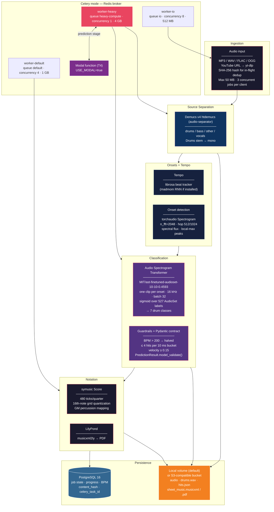
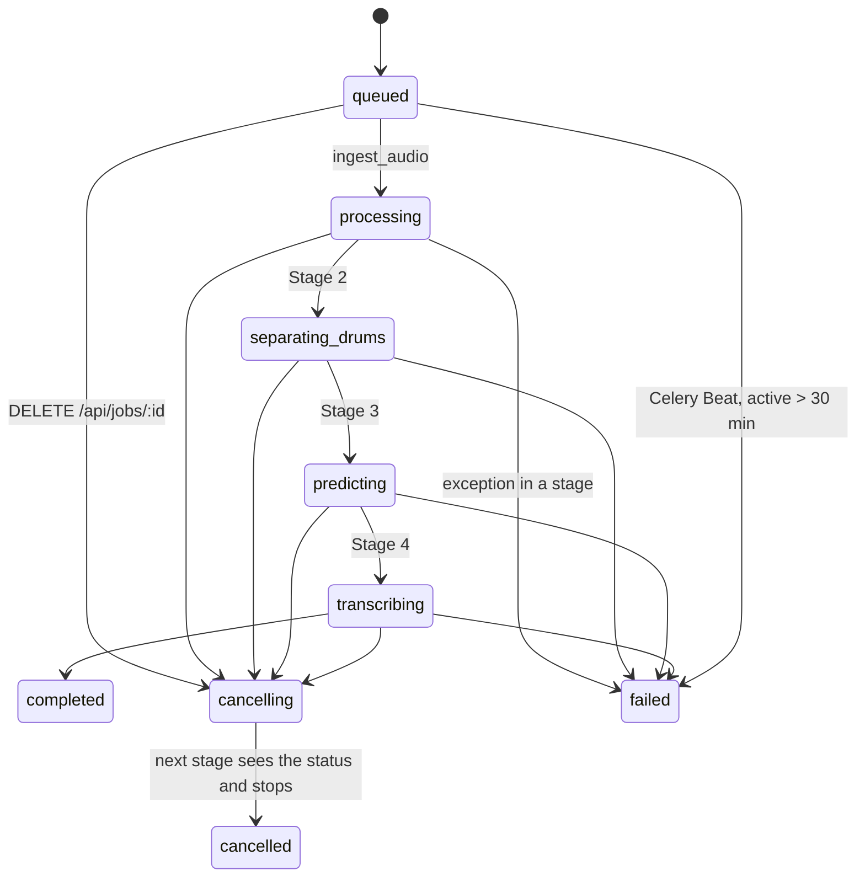

[](README.es.md)

# CDrumscribe — Automatic Drum Transcription

> **CDrumscribe** is the project name. The repository is `Automatic-Drum-Transcription`, and the code, containers and API title use the working name `DrumScribe`. All three refer to the same project.

CDrumscribe takes a song (an audio upload or a YouTube URL), separates the source audio, detects drum onsets, labels each onset with a pretrained audio classifier, and quantizes the hits into a drum score (MusicXML, plus a PDF engraved with LilyPond). It runs as a FastAPI backend with a Next.js frontend, in two modes: a single-container MVP and a Celery-based multi-worker stack.

<div align="center">

| Ingestion | Separation | Onsets + classification | Output |
|---|---|---|---|
| Upload / YouTube (yt-dlp) | Demucs v4 (`htdemucs`) via `audio-separator` | STFT spectral flux → AST (AudioSet) | symusic score → MusicXML / PDF |

</div>

---

## Project Status

This is a personal project. Here is where it stands, checked against the code on 2026-10-23 (after the pipeline fixes in #2):

- **Works end to end:** from a fresh clone, the MVP stack builds and runs a job through all four stages. On a 10-second test loop (CPU-only laptop), it completes in about 5 minutes and returns a downloadable MusicXML. The PDF stage renders when the score has notes (verified with a sample score).
- **Detection quality is the open problem:** on that synthetic loop, AST labeled **no hits**, so the score was empty, while the tempo estimate was right (99 vs 100 BPM). The cause is structural: AST expects ~10 s inputs, so each ~150 ms onset clip is padded to 1024 frames. That keeps drum-class probabilities around 0.1, below the 0.3 label threshold, and makes every clip cost a full 10 s forward pass. A classifier trained on short drum hits is the next step.
- **Not evaluated yet:** there is no transcription-accuracy benchmark (e.g. F-measure on ENST-Drums or MDB Drums). That is the main planned next step.
- **Classifier:** the AST model is the stock AudioSet checkpoint, used zero-shot. Its 527 AudioSet labels are mapped to drum classes by name. It has not been fine-tuned on drum data.

---

## System Architecture

Both deployment modes share one codebase. In **MVP mode** (`USE_CELERY=false`), the API runs the four stages in-process as a FastAPI background task. In **Celery mode**, the same four functions run as a Celery chain over three queues, each consumed by its own worker service. When `USE_MODAL=true`, the prediction stage calls a Modal function on an NVIDIA T4 instead of running locally.



### Stage-by-Stage Pipeline Sequence

```mermaid
sequenceDiagram
    participant API as FastAPI
    participant IO  as worker-io
    participant HV  as worker-heavy
    participant DF  as worker-default
    participant DB  as PostgreSQL
    participant S3  as Storage

    API->>DB: INSERT job (status=queued)
    API->>IO: dispatch Celery chain (or in-process in MVP mode)

    rect rgb(20, 40, 60)
    Note over IO: Stage 1 — Ingestion (5–15%)
    IO->>S3: download (YouTube) or locate upload, validate signal
    IO->>DB: progress=15
    end

    rect rgb(30, 20, 60)
    Note over HV: Stage 2 — Separation (20–50%)
    HV->>S3: load source audio
    HV->>HV: Demucs htdemucs via audio-separator
    HV->>S3: save drums.wav (mono, channel average)
    HV->>DB: progress=50
    end

    rect rgb(50, 20, 60)
    Note over HV: Stage 3 — Onsets + Classification (55–75%)
    HV->>HV: tempo estimate (librosa) → STFT spectral flux → peaks
    HV->>HV: AST batch=32 → sigmoid → 7 drum classes
    HV->>HV: guardrails + PredictionResult validation
    HV->>S3: save hits.json
    HV->>DB: progress=75
    end

    rect rgb(20, 40, 30)
    Note over DF: Stage 4 — Notation (80–100%)
    DF->>S3: load hits.json
    DF->>DF: symusic Score, 16th-note quantization
    DF->>DF: MusicXML export → LilyPond PDF
    DF->>S3: save sheet_music.musicxml + .pdf
    DF->>DB: progress=100, status=completed
    end
```



### Job Lifecycle



---

## Design Choices

### Onset Detection — Linear STFT and Spectral Flux

`app/ml/onset_detection.py` computes a **linear magnitude spectrogram** (`torchaudio.transforms.Spectrogram`, `n_fft=2048`, `power=1.0`). The hop is 512 samples when the estimated tempo is above 110 BPM and 1024 otherwise. The onset envelope is the positive spectral flux summed over frequency bins and normalized to [0, 1]. Onsets are local maxima above a fixed threshold (`ONSET_SENSITIVITY`, default 0.05).

The reasoning: Mel scaling compresses the high-frequency range, and that is where much of the difference between hi-hats, cymbals and snares lives. A linear spectrogram keeps that range for the flux computation. The transform runs in torch tensors, and peak picking is a simple loop over the NumPy envelope.

### Classification — AST, Zero-Shot

Each onset becomes a clip spanning about one 16th note at the estimated tempo. The clip is stretched or compressed to 8820 samples, resampled to 16 kHz and batched 32 at a time into `MIT/ast-finetuned-audioset-10-10-0.4593`. The model outputs sigmoid probabilities over the 527 AudioSet classes. Labels above 0.3 are mapped by name (`AUDIOSET_TO_DRUM_MAP`) to 7 drum classes: kick, snare, closed/open hi-hat, ride, crash, high tom. The model was trained on general AudioSet audio, not on isolated drum hits, so its per-class accuracy on this task is unmeasured (see Project Status).

### ONNX Export — Validated, Not Yet in the Serving Path

`backend/scripts/export_ast_to_onnx.py` exports AST to ONNX (opset 14, dynamic batch and sequence axes). It checks that ONNX Runtime outputs match PyTorch within `1e-4`, then times both. Inference in `app/ml/engine.py` still uses PyTorch. Switching it to ONNX Runtime is planned.

Measured on 2026-10-22 by running that script unchanged inside the MVP image (`onnxscript` added, since torch 2.14 needs it to export). Setup: AMD Ryzen 5 5500U under WSL2, CPU only, torch 2.14.1+cpu, onnxruntime 1.31 with default session options, one 10-second input (`1×1024×128` filterbank), 5 warm-up runs and 100 timed runs each. Outputs matched (max abs diff 1.2e-05). The **ONNX Runtime run was slower: 6.59 s vs 3.20 s per forward pass (0.49x)**. The speedup that older docs quote is not reproduced here. Graph optimization, thread settings and quantization have not been explored yet.

### Notation — symusic

`app/services/transcription.py` builds a `symusic.Score` at 480 ticks per quarter note. It maps each drum class to a General MIDI percussion note on a drum track and snaps note onsets to a 16th-note grid derived from the tempo. It also logs the average and maximum quantization drift in milliseconds. symusic is a C++-backed library. Its published benchmarks show MIDI parsing much faster than `mido`, `pretty_midi` and `miditoolkit` ([per symusic's benchmarks](https://github.com/Yikai-Liao/symusic#benchmark)). This project has not benchmarked its own quantization step.

---

## Reliability Measures

| Concern | What the code does |
|---|---|
| Model load cost | The separation model and AST are loaded once per process (lock-guarded singletons). Celery `worker-heavy` preloads both at startup (`WORKER_MODE=true`). |
| Duplicate uploads | Uploads are SHA-256 hashed. If the same client already has an in-flight job with the same hash, the API returns that job instead of creating a new one. |
| Retries after partial failure | Stage 2 skips separation if `drums.wav` already exists. Stage 3 reuses `hits.json` if it passes `PredictionResult` validation. |
| Memory | `worker-heavy` runs with `concurrency=1` and a 4 GB limit. Stages release large arrays and call `gc.collect()` / `torch.cuda.empty_cache()`. |
| Image size | `torch`/`torchaudio` are installed from the PyTorch CPU wheel index to avoid pulling the CUDA stack. |
| Stuck jobs | In Celery mode, Celery Beat marks jobs active for more than 30 minutes as `failed` and removes artifacts older than `ARTIFACT_TTL_HOURS` (24 h). |

### Queue Design

`docker-compose.yml` defines three queues, each consumed by its own worker service, so slow downloads and CPU-heavy model inference do not compete for the same worker slots:

```
io              concurrency=8   512 MB   YouTube download, file validation
heavy-compute   concurrency=1   4 GB     Demucs separation + AST inference
default         concurrency=4   1 GB     symusic quantization, MusicXML/PDF export
```

`worker-heavy` runs one task at a time because both models are held in memory in a 4 GB container.

### Pydantic Contracts at the ML Boundary

```python
class DrumHit(BaseModel):
    time:       float = Field(ge=0.0)
    instrument: str   = Field(pattern="^(kick|snare|hihat_closed|hihat_open|ride|crash|tom_high|tom_mid|tom_low)$")
    velocity:   float = Field(ge=0.0, le=1.0)
    model_config = {"frozen": True}
```

`PredictionResult` also requires BPM in [40, 300], confidence in [0, 1], hits sorted by time, and a `hit_summary` that matches the hit list. `run_prediction()` validates its output with `model_validate()` before returning it. The worker then applies three heuristics (`app/ml/guardrails.py`) before writing `hits.json`:

- **Tempo doubling:** BPM above 200 is halved and flagged `bpm_unreliable`.
- **Polyphony cap:** at most 4 hits per 10 ms bucket, keeping the highest-confidence ones.
- **Confidence floor:** hits with `velocity < 0.15` are dropped.

---

## Serverless GPU (Modal)

`backend/infrastructure/modal_app.py` defines a Modal app (`drumscribe-ml`) with one function, `process_audio_pipeline`. It runs on a T4 with 8 GB RAM and a 600 s timeout, and the model weights are baked into the image at build time. It runs separation, AST classification and the guardrails, then returns a Pydantic-validated result. With `USE_MODAL=true`, the `predict_hits` stage sends the audio to that function. If the Modal SDK or the deployed function is not available, it falls back to local inference. The author has deployed it and run jobs through it manually. Latency and cost have not been measured.

Cost rationale (not measured): Modal bills per second of use and scales to zero, which suits sporadic, bursty jobs better than an always-on GPU instance.

---

## Tech Stack

| Layer | Technology | Role |
|---|---|---|
| **Frontend** | Next.js 16, React 19, TypeScript | Upload UI, Server Actions, SSE progress (`EventSource`) |
| **Sheet music render** | OpenSheetMusicDisplay | In-browser MusicXML rendering |
| **API** | FastAPI, SQLAlchemy (async), Pydantic v2 | Job API, SSE stream, typed schemas |
| **Task queue** | Celery + Redis | Three queues; Celery Beat for cleanup and stale-job expiry |
| **Separation** | Demucs v4 `htdemucs` via `audio-separator` | Drum-stem separation; model set by `SEPARATION_MODEL` |
| **Onset detection** | torchaudio STFT + spectral flux | Onset times |
| **Tempo** | librosa (madmom when installed) | BPM estimate for windowing and quantization |
| **Hit classification** | AST (AudioSet), PyTorch | Onset clip → drum class; ONNX export script available |
| **Symbolic music** | symusic | Score building and 16th-note quantization |
| **PDF export** | LilyPond (`musicxml2ly`) | Server-side engraving |
| **Storage** | Local volume, or any S3-compatible bucket via boto3 | `S3_ENDPOINT_URL` targets Cloudflare R2 or MinIO |
| **Database** | PostgreSQL 16 | Job state, content hash |
| **Observability** | structlog, Prometheus client, OpenTelemetry SDK | JSON logs, `/metrics`, tracer provider (see below) |
| **Serverless GPU** | Modal (NVIDIA T4) | Optional remote inference, `USE_MODAL=true` |

---

## Quick Start

### MVP Mode (no queue, no Redis)

```bash
git clone https://github.com/MatPizzolo/Automatic-Drum-Transcription.git
cd Automatic-Drum-Transcription
cp .env.example .env
docker compose -f docker-compose.mvp.yml up -d
# → http://localhost:3000       (frontend)
# → http://localhost:8000/docs  (API docs)
```

> The first build installs PyTorch, `audio-separator` and LilyPond, so it takes a while (about 30 minutes on a laptop with a home connection). Models are downloaded on the first job, not at startup: the Demucs `htdemucs` checkpoint (~80 MB) and the AST weights from Hugging Face. On CPU, a job on a 10-second clip takes about 5 minutes.

### Celery Mode

```bash
docker compose -f docker-compose.yml up -d                          # API, 3 workers, Beat, Redis, Postgres
docker compose -f docker-compose.yml --profile observability up -d  # + Jaeger
docker compose -f docker-compose.yml up -d --scale worker-heavy=2   # more heavy-compute workers
```

Running plain `docker compose up -d` also applies `docker-compose.override.yml`, which switches to dev settings (hot reload, `npm run dev`, mounted source).

| Service | URL |
|---|---|
| Frontend | http://localhost:3000 |
| API | http://localhost:8000 |
| API Docs | http://localhost:8000/docs |
| Prometheus metrics | http://localhost:8000/metrics |
| Jaeger UI | http://localhost:16686 |

---

## API Reference

| Method | Endpoint | Description |
|---|---|---|
| `POST` | `/api/jobs` | Create a job: multipart `file` **or** `youtube_url`, plus optional `title`, `bpm`, `webhook_url` |
| `GET` | `/api/jobs/{id}` | Status, progress (0–100), warnings |
| `GET` | `/api/jobs/{id}/result` | Hits, BPM, confidence, download URLs |
| `GET` | `/api/jobs/{id}/download/musicxml` | Download MusicXML |
| `GET` | `/api/jobs/{id}/download/pdf` | Download PDF |
| `DELETE` | `/api/jobs/{id}` | Cancel an active job (marks it `cancelling`, revokes the Celery chain without killing the running task) and delete its artifacts |
| `GET` | `/api/jobs/{id}/events` | Server-Sent Events stream of status updates |
| `GET` | `/api/health` | Database, Redis (Celery mode) and model cache directory checks |

---

## Observability

- **Structured logs:** JSON via `structlog`. Each HTTP request gets a correlation ID (`X-Request-ID`), and each task logs `job_id` and elapsed milliseconds.
- **Prometheus metrics:** `inference_latency_seconds` (per stage), `jobs_total`, `jobs_failed_total`, `active_jobs_gauge` and `audio_duration_seconds_processed`, exposed by the API at `/metrics`. Celery workers record the same metrics in their own processes but do not expose an endpoint yet.
- **Tracing:** the API configures an OpenTelemetry tracer provider with an OTLP/HTTP exporter, and the instrumentation packages for FastAPI and Celery are installed. No instrumentor is enabled yet, and `OTLP_ENDPOINT` is not wired to the Jaeger service in Compose. End-to-end tracing is planned.
- **Health endpoint:** `GET /api/health` checks the database, Redis (Celery mode only) and whether the model cache directory exists.
- **Stale jobs:** in Celery mode, Celery Beat marks jobs active for more than 30 minutes as `failed`.

---

## Testing

```bash
cd backend
pip install -r requirements-worker.txt -r requirements-test.txt
pytest tests/unit/ tests/regression/       # guardrails, contracts, onset detection, golden files
pytest tests/integration/ -m integration   # API + DB; needs PostgreSQL and Redis running
```

`pyproject.toml` deselects `integration` and `slow` tests by default, so integration tests only run with `-m integration`.

Current state (2026-10-23): **128 passed** in the default selection; the `slow` AST test also passes when run with `-m slow`. CI runs the same install (CPU torch first, then worker and test requirements).

---

## Documentation

| Guide | Contents |
|---|---|
| [System Architecture](docs/ARCHITECTURE.md) | Data flow, security, serverless design |
| [ML Pipeline](docs/ML_PIPELINE.md) | Separation, onsets, AST, symusic |
| [Modal Deployment](docs/MODAL_DEPLOYMENT.md) | Serverless GPU setup |
| [Production Deployment](docs/DEPLOYMENT.md) | Vercel + Fly.io + Modal + R2 walkthrough |
| [API Reference](docs/API_REFERENCE.md) | REST API details |
| [Testing](docs/TESTING.md) | Test layout and how to run it |

> The guides in `docs/` predate this README revision and still contain unmeasured figures (cost estimates, speedups). Where they disagree, this README reflects the current code.

---

<div align="center">

Built by **Mateo Pizzolo**

</div>
